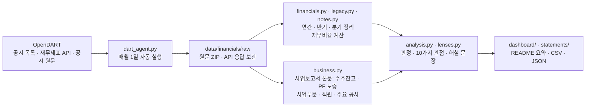

[](https://hsc-class01.github.io/KTG_Hyundai/dashboard/)

[📊 재무제표 10년 시각화 바로가기](https://hsc-class01.github.io/KTG_Hyundai/statements/)

# 현대건설 OpenDART 재무분석 에이전트

금융감독원 전자공시(DART)에서 **현대건설(000720)** 의 사업·반기·분기보고서를 **2010년부터** 모아 주요 재무 숫자와 재무비율을 계산하고, 사업보고서 본문의 수주잔고·PF 보증까지 읽어 **두 가지 시각화**(사업보고서 대시보드, 재무제표 10년 시각화)를 만드는 Python 에이전트입니다. GitHub Actions가 **매월 1일 오전 9시 17분(한국시간)** 에 자동으로 실행해, 새 보고서가 나왔으면 숫자와 분석 문장까지 다시 씁니다.

- **사업보고서 대시보드**: https://hsc-class01.github.io/KTG_Hyundai/dashboard/
- **재무제표 10년 시각화**: https://hsc-class01.github.io/KTG_Hyundai/statements/
- **자동 실행 기록**: [Actions → Financial Agent](https://github.com/HSC-Class01/KTG_Hyundai/actions/workflows/financial-agent.yml)
- **데이터(CSV)**: [연간](data/financials/annual.csv) · [반기](data/financials/half_year.csv) · [분기](data/financials/quarterly.csv)

## 이번 달 요약 (자동 작성)

아래 내용은 에이전트가 매월 새 숫자로 다시 씁니다.

<!-- AUTO:SUMMARY:START -->
> 마지막 확인 **2026-10-26** · 가장 최근 반영 보고서 **반기보고서 (2026.06)** (2026.08.14 접수) · 다음 자동 확인 **2026-11-01**

연간 매출은 2010년 11.4조 원에서 2025년 31.1조 원으로 **2.73배**가 됐습니다. 하지만 100원어치 공사를 해서 남기는 돈은 **6.4원에서 2.1원**으로 줄었고, 본업에서 들어오는 현금은 **4년 연속 마이너스**입니다.

교수님 자료(재무제표·재무비율 실무가이드)의 분석 순서대로 본 판정입니다.

| 단계 | 판정 | 한 줄 답 |
| --- | --- | --- |
| 1 매출 성장 | 🟢 성장 | 2010년 이후 매출이 2.73배가 됐습니다. 연평균 6.9% 성장입니다. |
| 2 이익률 | 🟡 약해짐 | 2010년엔 6.4원, 2025년엔 2.1원이 남았습니다. 2024년엔 3.9원 손해였습니다. |
| 3 현금흐름 | 🔴 경고 | 장부상 이익은 흑자인데, 현금은 4년 연속 빠져나갔습니다. |
| 4 차입 부담 | 🟢 양호 | 영업이익으로 보면 이자를 갚을 여력은 충분합니다. 다만 영업현금흐름이 마이너스라 모자란 현금을 빌려서 메우고 있어, 빚은 늘고 있습니다. |
| 5 투자수익률 | 🟡 주의 | 2025년 ROIC 6.7%로 빌린 돈의 세후 이자율(3.0%)보다는 높지만, 단순 기준 8%에는 못 미칩니다. |
| 6 주가 수준 | ℹ️ 참고 | PBR 1.09배: 주가가 장부상 순자산보다 높게 거래됩니다. |

지표 조합 신호(가이드 5장): **순이익 증가 + CFO 감소**(순이익 −0.77 → 0.56조, 영업현금흐름 −0.12 → −0.75조 원)

사업보고서 본문(수주·PF): 수주잔고 **104.9조 원**(2026년 6월 말, 매출 3.6년 치) · 2025년 신규 수주 25.5조 원(현대건설 단독) · PF 보증 14.2조 원(자본의 1.3배)

**가장 최근 분기: 2026년 2분기(4~6월)**

- 2026년 2분기(4~6월) 매출은 **6.84조 원**으로 1년 전보다 11.4% 줄었고, 직전 분기보다 8.9% 늘었습니다.
- 영업이익은 **2,618억 원**(영업이익률 3.8%)으로 1년 전 같은 분기(2,170억 원)보다 많습니다.
- 이 분기 영업이익은 이자비용의 **5.3배**입니다(이자보상배율).
- 상반기 누적 영업활동현금흐름은 **−1조 6,771억 원**입니다. 이익은 흑자인데 현금은 빠져나갔습니다.
- 6월 말 부채비율 **155%**, 유동비율 148%, 순차입금 0.94조 원, 받을 돈(매출채권+미청구공사) 11.72조 원입니다.

최근 실적 (연결, 금액 단위: 억 원 · ROE·ROIC는 연간만)

| 기간 | 매출액 | 영업이익 | 영업이익률(%) | EBITDA | 당기순이익 | 영업현금흐름 | FCF | 부채비율(%) | 이자보상배율(배) | ROE(%) | ROIC(%) |
| --- | ---: | ---: | ---: | ---: | ---: | ---: | ---: | ---: | ---: | ---: | ---: |
| 2021년 | 180,655 | 7,535 | 4.2 | 9,294 | 5,544 | 10,094 | 8,873 | 108 | 13.0 | 6.1 | 5.8 |
| 2022년 | 212,391 | 5,749 | 2.7 | 7,613 | 4,709 | −1,435 | −3,103 | 111 | 13.1 | 4.9 | 4.4 |
| 2023년 | 296,514 | 7,854 | 2.6 | 9,884 | 6,543 | −7,147 | −9,518 | 127 | 12.3 | 6.4 | 6.7 |
| 2024년 | 326,703 | −12,634 | −3.9 | −10,414 | −7,662 | −1,188 | −3,181 | 179 | −12.6 | −7.6 | −11.1 |
| 2025년 | 310,629 | 6,530 | 2.1 | 8,539 | 5,591 | −7,483 | −8,641 | 175 | 5.3 | 5.7 | 6.7 |
| 2026년 상반기 | 131,236 | 4,427 | 3.4 | 5,477 | 3,637 | −16,771 | −18,581 | 155 | 4.8 | – | – |

주가 수준(2026.10 월말 종가 89,800원): 시가총액 10.09조 원 · PER 22.5배 · PBR 1.09배 · EV/EBITDA 14.9배

전체 표: [연간](https://hsc-class01.github.io/KTG_Hyundai/dashboard/#annual) · [반기](https://hsc-class01.github.io/KTG_Hyundai/dashboard/#half) · [분기](https://hsc-class01.github.io/KTG_Hyundai/dashboard/#quarter) · [재무제표 10년 시각화](https://hsc-class01.github.io/KTG_Hyundai/statements/) · CSV: [annual](data/financials/annual.csv) · [half_year](data/financials/half_year.csv) · [quarterly](data/financials/quarterly.csv)
<!-- AUTO:SUMMARY:END -->

## 두 가지 시각화

| 화면 | 무엇을 보여 주나 |
|---|---|
| [사업보고서 대시보드](https://hsc-class01.github.io/KTG_Hyundai/dashboard/) | ① **건설사가 돈을 버는 구조**(수주 → 공사·매출 → 이익 → 현금 → 재무 체력 → 다음 수주 자격, 발주 방식, 사업부문별 매출) → ② **그래서 사업보고서가 중요한 이유**(단계마다 보고서의 어느 장을 봐야 하는지) → ③ **수주·PF**(수주잔고, 일감 연수, 신규 수주, 진행 중인 큰 공사, PF 보증) → ④ **10가지 관점 요약** → 교수님 가이드 6단계 → Annual·Half-year·Quarterly 표 → 동종업계 |
| [재무제표 10년 시각화](https://hsc-class01.github.io/KTG_Hyundai/statements/) | 최근 10개 사업연도의 **손익계산서·재무상태표·현금흐름표**를 그림으로 보고, 재무비율 **10가지 관점**(수익성·안정성·유동성·활동성·성장성·생산성·현금흐름·시장가치·종합 분석(듀퐁 분해·10년 위치표)·주가 반영)을 관점마다 차트와 자동 해설로 풉니다 |

두 화면 모두 매월 1일 에이전트가 새 공시로 다시 만듭니다. 판정은 절대 기준이 아니라 ‘최근 10년 안에서 지금이 어디쯤인가’입니다.

## 에이전트가 하는 일



1. **수집**: 2010년 이후 정기보고서(사업·반기·1분기·3분기) 목록을 받고, 기간마다 가장 최근 보고서(정정 공시 포함)를 고릅니다. 보고서 원문 ZIP과 재무제표 API 응답을 `data/financials/raw/`에 보관합니다.
2. **정리**: 누적 보고서로 **Annual(연간) · Half-year(반기) · Quarterly(분기)** 표를 만듭니다. 2분기 = 반기 − 1분기, 4분기 = 연간 − 3분기 누적처럼 빼서 계산합니다.
3. **분석**: 교수님 자료 **「재무제표·재무비율 실무가이드」** 의 정의와 분석 순서(매출 성장 → 이익률 → 현금흐름 → 차입 부담 → 투자수익률 → 주가 수준)를 따라 재무비율을 계산하고, 단계마다 정해진 규칙으로 판정해 해설 문장을 씁니다. 가이드 5장의 ‘지표 조합 신호’도 자동으로 점검합니다.
4. **게시**: 대시보드, 이 README의 요약과 동종업계 표, CSV를 갱신하고 저장소에 커밋합니다. GitHub Pages가 바뀐 화면을 게시합니다.

새 보고서가 없는 달에는 숫자는 그대로 두고 확인 기록만 남깁니다.

## 교수님 가이드와 대시보드 대응

| 가이드 | 대시보드에서 보는 곳 |
|---|---|
| 2장 주요 재무제표 수치: 총자산·현금·매출채권·재고자산·유형자산·총부채·이자부차입금·자본 / 매출·매출총이익·판관비·영업이익·세전이익·당기순이익·지배주주순이익·EBITDA / 영업·투자·재무활동현금흐름·CAPEX·FCF·순차입금 | 아래쪽 Annual · Half-year · Quarterly 표 (CSV 포함) |
| 3장 주요 재무비율: 수익성(매출총이익률·영업이익률·순이익률·EBITDA 마진·ROA·ROE·ROIC), 유동성·안정성(유동·당좌·부채·자기자본비율·차입금의존도·이자보상배율·순차입금/EBITDA), 활동성·성장성(총자산회전율·DSO·DIO·DPO·CCC·매출증가율·CFO/순이익), 시장가치(PER·PBR·EV/EBITDA·FCF 수익률) | 같은 표의 열 묶음(버튼으로 골라 보기)과 단계별 차트 |
| 4장 실무 필수 분석 흐름 6단계 | 맨 위 요약 카드 6개, STEP 1~6 섹션 |
| 5장 지표 조합으로 읽는 실무 신호 | ‘조합 신호’ 섹션: 최근 두 해로 8가지 조합 자동 점검 |
| 6장 실무 검토 체크리스트 | ‘자료’ 섹션의 반영 표 |
| 7장 해석 시 주의사항 | 0 이하 분모 제외, 적자 기간 PER 미계산, 건설업 지표(받을 돈·미청구공사·미리 받은 돈) 추가 |
| 분석 관점: 수익성·안정성·유동성·활동성·성장성·생산성·현금흐름·시장가치·종합 분석·주가 반영 | 대시보드 ‘10가지 관점’ 카드, 재무제표 10년 시각화의 관점별 섹션 |

## 처음 설정하기 (API 키 입력)

1. **OpenDART 인증키 발급**: [OpenDART](https://opendart.fss.or.kr/) 회원가입 → 인증키 신청/관리 → 40자리 인증키를 받습니다.
2. **키를 GitHub에 저장**: 저장소 **Settings → Secrets and variables → Actions → New repository secret**
   - Name: `DART_API_KEY`
   - Secret: 발급받은 40자리 인증키
   - 키는 코드나 파일에 쓰지 않습니다. 워크플로가 실행될 때만 환경변수로 전달됩니다.
3. **GitHub Pages**: **Settings → Pages**. Source가 *Deploy from a branch (main / root)* 이든 *GitHub Actions* 든 그대로 동작합니다. 워크플로가 설정을 확인해서 알맞게 게시합니다.
4. **About에 대시보드 링크 걸기**: 저장소 첫 화면 오른쪽 **About** 옆 ⚙️(톱니) → **Website**에 `https://hsc-class01.github.io/KTG_Hyundai/dashboard/` 입력 → **Save changes**.
5. **첫 실행**: **Actions → Financial Agent → Run workflow → Run workflow**. 3~5분 뒤 대시보드에 반영됩니다.

> 키가 없거나 OpenDART가 응답하지 않아도 워크플로는 실패로 끝나지 않습니다. 저장된 숫자로 화면을 다시 만들고, 무엇이 문제였는지 대시보드의 **업데이트 상태**, `data/financials/status.json`, Actions 실행 요약에 남깁니다.

## 자동 업데이트

| 언제 | 무엇을 |
|---|---|
| 매월 1일 09:17 (KST) | `cron: '17 0 1 * *'` (UTC 00:17). GitHub 사정으로 몇 분~수십 분 늦을 수 있습니다. |
| 직접 실행 | Actions → Financial Agent → Run workflow |
| 코드를 고쳐서 push할 때 | `scripts/`, `config/`, `tests/`, 워크플로 파일이 바뀌면 자동 실행 |

- 실행 순서: 계산 규칙 테스트 → OpenDART 수집 → 표·해설·대시보드 생성 → 커밋 → GitHub Pages 게시
- 공개 저장소의 예약 실행은 60일 동안 저장소 활동이 없으면 GitHub가 멈춥니다. 에이전트는 매달 확인 기록(`status.json`)을 커밋하므로 활동이 이어집니다.
- 분기보고서는 분기 종료 후 45일, 사업보고서는 90일 안에 공시됩니다. 그래서 대시보드에는 보통 1~2개월 전 분기까지 반영됩니다.

## 데이터 범위와 계산 기준

| 기간 | 숫자를 가져온 곳 |
|---|---|
| 2015년 이후 연간, 2016년 이후 분·반기 | OpenDART 단일회사 전체 재무제표 API (연결재무제표) |
| 2013~2014년 연간, 2015년 분·반기 손익·현금흐름 | 다음 해 보고서 API의 비교 숫자 + 공시 원문 |
| 2010~2015년 | 공시 원문(XML)에 들어 있는 XBRL 재무제표 표. 표 제목의 기간·단위로 열을 판단 |
| 감가상각비·이자비용 (EBITDA·이자보상배율용) | 재무제표 본문에 없어 공시 원문의 연결재무제표 주석(현금흐름표 조정 항목)에서 읽음 |
| 주가 · 주식수 (PER·PBR 등) | 월말 종가: 네이버 금융(실패하면 Yahoo Finance) · 발행주식수: OpenDART ‘주식의 총수 현황’(2015년부터) |
| 수주잔고 (2014년부터) | 사업보고서 Ⅱ장 ‘수주상황’ 표의 회사별 국내·해외 계약잔액 합계. 앞뒤 보고서와 15% 넘게 어긋나는 값(표 범위가 다른 보고서)은 그래프에서 뺌 |
| 신규 수주 | Ⅱ장 ‘지배회사 현황’ 문단의 수주실적(현대건설 단독) |
| PF 보증 (2022년 말부터) | 연결 주석 ‘우발부채 및 약정사항’의 보증금액 기준 신용보강. 2023년 사업보고서부터 바뀐 공시 기준이라 그 이후만 씀 |
| 사업부문별 매출 · 주요 공사 · 국내 건설시장 · 원자재 | 가장 최근 사업보고서(주요 공사는 가장 최근 정기보고서)의 Ⅱ장 표와 문단 |
| 직원 수 · 1인 평균 급여 · 단독 매출 (생산성) | Ⅷ장 직원 현황, Ⅲ장 요약재무정보(별도) |

- **원문 추출 정확도**: 2015~2016년 보고서는 API와 원문을 모두 읽어 같은 숫자가 나오는지 비교합니다(대시보드 ‘자료와 검증’에 결과 표시).
- **Annual**: 1~12월 실적, 12월 말 재무상태 · **Half-year**: 상반기(1~6월)와 하반기(연간 − 상반기) · **Quarterly**: 각 분기 3개월 실적
- **재무비율**: 가이드 3장의 계산식을 그대로 씁니다. ROA·ROE·ROIC·회전율·회전일수처럼 손익과 잔액을 함께 쓰는 지표는 전년 말·올해 말 평균 잔액을 쓰므로 연간 표에만 있습니다. 정의는 대시보드 ‘자료’ 섹션과 표 머리글(마우스를 올리면 계산식)에 있습니다.
- **ROIC** = 영업이익 × (1 − 실효세율) ÷ 평균 투하자본(자본총계 + 순차입금). WACC는 공시 숫자가 아니어서 세후 차입 이자율과 단순 기준 8%로 비교합니다.
- **건설업 지표**: 받을 돈(매출채권 + 미청구공사), 미리 받은 돈(초과청구공사 + 공사및분양선수금), 원가율, 차입 이자율
- 모든 숫자는 연결재무제표 기준이고, 당기순이익은 비지배지분 몫을 포함합니다. 숫자가 없거나 분모가 0 이하이면 0으로 채우지 않고 비워 둡니다.

## 파일 구조

```text
scripts/dart_agent.py      에이전트 본체: 수집 → 정리 → 화면 생성 (실행 파일)
scripts/financials.py      계정 매칭, 연간·반기·분기 계산, 재무비율
scripts/legacy.py          2010~2015년 공시 원문 표에서 숫자 읽기
scripts/analysis.py        판정 규칙과 자동 해설 문장
scripts/notes.py           공시 주석에서 감가상각비·이자비용 읽기
scripts/market.py          주가·주식수로 PER·PBR·EV/EBITDA 계산
scripts/business.py        사업보고서 본문에서 수주잔고·PF 보증·사업부문·직원·주요 공사 읽기
scripts/lenses.py          재무비율 10가지 관점의 정의와 10년 위치 판정
scripts/dashboard.py       사업보고서 대시보드 HTML과 README 자동 구역
scripts/report_view.py     대시보드 앞부분: 돈 버는 구조 · 사업보고서가 중요한 이유 · 수주·PF · 10가지 관점
scripts/statements.py      재무제표 10년 시각화 HTML
scripts/package_project.py 제출용 ZIP 만들기
config/company.json        분석 대상 회사, 동종기업, 시공능력평가 순위
data/financials/           annual.csv · half_year.csv · quarterly.csv · dashboard.json · business.json · status.json
data/financials/raw/       공시 원문 ZIP, 재무제표 API 응답(JSON), market/ 주가·주식수
dashboard/index.html       자동 생성되는 사업보고서 대시보드
statements/index.html      자동 생성되는 재무제표 10년 시각화
tests/test_financials.py   계산 규칙 테스트
.github/workflows/financial-agent.yml  매월 1일 자동 실행
```

다른 회사로 바꾸려면 `config/company.json`의 회사 이름·종목코드·고유번호와 동종기업 목록을 바꾸면 됩니다.

## 내 컴퓨터에서 실행

Python 3.10 이상, 추가 설치 없음(표준 라이브러리만 사용).

```bash
# 저장된 자료로 화면만 다시 만들기 (키 필요 없음)
python scripts/dart_agent.py --offline

# OpenDART에서 새 자료 받기 (키는 환경변수로만 전달)
export DART_API_KEY=발급받은키          # Windows PowerShell: $env:DART_API_KEY = "발급받은키"
python scripts/dart_agent.py

# 테스트
python -m unittest discover -s tests -v

# 결과 보기
python -m http.server 8000      # → http://localhost:8000/dashboard/ · http://localhost:8000/statements/
```

## 제출용 ZIP (숨김 파일 없음)

```bash
python scripts/package_project.py     # → dist/KTG_Hyundai_agent.zip
```

- ZIP 안에는 점(.)으로 시작하는 파일·폴더(`.git`, `.github`, `.gitignore` 등)가 하나도 없습니다.
- 워크플로 파일은 ZIP의 `workflows/financial-agent.yml`에 들어 있습니다. 새 저장소에 올릴 때는 GitHub 웹에서 **Add file → Create new file** → 파일 이름에 `.github/workflows/financial-agent.yml` 입력 → 내용 붙여넣기 → Commit 하면 됩니다. 자세한 순서는 [SETUP.md](SETUP.md)에 있습니다.
- 용량이 큰 공시 원문 ZIP은 제출 ZIP에서 빼고, 첫 실행 때 에이전트가 다시 받습니다.

## 국내 동종업계 (Peer firms)

<!-- AUTO:PEERS:START -->
2025년 사업보고서 기준으로 현대건설의 매출은 6개사 중 **2위**, 영업이익률은 **5위**, 부채비율은 낮은 순서로 **4위**입니다.

| 시평 순위 | 회사 | 종목코드 | 주요 사업 | 기준 | 매출액(억 원) | 영업이익(억 원) | 영업이익률(%) | ROE(%) | 부채비율(%) | 유동비율(%) | PER(배) | PBR(배) |
| ---: | --- | --- | --- | --- | ---: | ---: | ---: | ---: | ---: | ---: | ---: | ---: |
| 1위 | [삼성물산](https://dart.fss.or.kr/dsaf001/main.do?rcpNo=20260312000856) | 028260 | 건축·토목·플랜트, 상사·패션·리조트·바이오 | 2025년 | 407,422 | 32,927 | 8.1 | 6.8 | 50.5 | 154.0 | 20.1 | 0.98 |
| 2위 | [**현대건설**](https://dart.fss.or.kr/dsaf001/main.do?rcpNo=20260318001395) | 000720 | 건축·주택·토목·플랜트·원자력 | 2025년 | 310,629 | 6,530 | 2.1 | 5.5 | 174.8 | 147.9 | 27.1 | 1.22 |
| 3위 | [GS건설](https://dart.fss.or.kr/dsaf001/main.do?rcpNo=20260701000624) | 006360 | 주택·건축·인프라·플랜트 | 2025년 | 124,503 | 4,378 | 3.5 | 1.7 | 234.2 | 115.9 | 25.9 | 0.51 |
| 5위 | [대우건설](https://dart.fss.or.kr/dsaf001/main.do?rcpNo=20260318001029) | 047040 | 주택·건축·토목·플랜트 | 2025년 | 80,546 | −8,154 | −10.1 | −26.4 | 284.5 | 194.1 | – | 1.77 |
| 6위 | [DL이앤씨](https://dart.fss.or.kr/dsaf001/main.do?rcpNo=20260814003447) | 375500 | 주택·토목·플랜트 | 2025년 | 74,024 | 3,870 | 5.2 | 7.1 | 84.4 | 151.2 | 5.9 | 0.41 |
| 10위 | [IPARK현대산업개발](https://dart.fss.or.kr/dsaf001/main.do?rcpNo=20260318001249) | 294870 | 주택·개발사업(디벨로퍼) | 2025년 | 41,470 | 2,486 | 6.0 | 4.9 | 136.5 | 143.3 | 9.3 | 0.46 |

- 순위: 2026년 국토교통부 시공능력평가(토목건축공사업) ([이데일리, 2026.07.30](https://v.daum.net/v/20260730110336152))
- 재무 숫자: 각 회사의 가장 최근 사업보고서 연결재무제표 (OpenDART, 매월 자동 갱신). ROE는 기말 자본 기준, PER·PBR은 2026.10 월말 주가 기준. 동종기업 목록은 `config/company.json`에서 바꿀 수 있습니다.
- 삼성물산: 건설 외 사업 비중이 커서 연결 전체 숫자를 그대로 비교하면 안 됩니다
- GS건설: 주택 비중이 높아 분양 경기 영향을 크게 받습니다
- 대우건설: 해외 플랜트·원전 등 대형 프로젝트 비중
- DL이앤씨: 2021년 분할 신설 법인이라 이전 연도 비교에 주의
- IPARK현대산업개발: 2026년 HDC현대산업개발에서 회사 이름을 바꿨습니다
<!-- AUTO:PEERS:END -->
